# Business OS — Entity Relationship Diagram (ERD)

Every tenant-scoped entity includes `organization_id UUID NOT NULL REFERENCES organizations(id)`, `created_at TIMESTAMPTZ`, `updated_at TIMESTAMPTZ`, and optimistic concurrency `version INT DEFAULT 1` (for offline-syncable entities).

```mermaid
erDiagram
    organizations ||--o{ organization_members : has
    users ||--o{ organization_members : belongs_to
    users ||--o{ sessions : owns
    users ||--o{ devices : registers
    organizations ||--o{ devices : scopes
    roles ||--o{ role_permissions : grants
    permissions ||--o{ role_permissions : assigned_in
    users ||--o{ user_roles : holds
    roles ||--o{ user_roles : maps

    organizations ||--o{ contact_groups : defines
    contact_groups ||--o{ contacts : categorizes
    contacts ||--o{ contact_addresses : has
    contacts ||--o{ contact_accounts : links
    contacts ||--o{ contact_transactions : records

    organizations ||--o{ categories : defines
    organizations ||--o{ brands : defines
    organizations ||--o{ units : defines
    products }o--|| categories : in
    products }o--|| brands : made_by
    products }o--|| units : base_unit
    products ||--o{ product_units : conversions
    products ||--o{ barcodes : identified_by
    products ||--o{ product_prices : priced_with
    products ||--o{ product_attributes : described_by
    products ||--o{ product_images : displays

    organizations ||--o{ account_groups : groups
    account_groups ||--o{ accounts : contains
    organizations ||--o{ fiscal_years : tracks
    fiscal_years ||--o{ accounting_periods : splits_into
    organizations ||--o{ cost_centers : tracks
    fiscal_years ||--o{ journal_entries : scopes
    accounting_periods ||--o{ journal_entries : belongs_to
    journal_entries ||--|{ journal_entry_lines : balances
    accounts ||--o{ journal_entry_lines : debits_credits
    accounts ||--o{ opening_balances : initializes

    organizations ||--o{ warehouses : operates
    warehouses ||--o{ stock_documents : records
    stock_documents ||--|{ stock_document_items : lists
    stock_documents ||--o{ stock_ledger : posts
    products ||--o{ stock_ledger : tracks
    warehouses ||--o{ stock_ledger : holds
    warehouses ||--o{ stock_reservations : reserves
    warehouses ||--o{ stock_counts : audits
    stock_counts ||--|{ stock_count_items : lines
    warehouses ||--o{ stock_transfers : transfers

    contacts ||--o{ purchase_orders : supplies
    contacts ||--o{ purchase_invoices : bills
    purchase_invoices ||--|{ purchase_invoice_items : lines
    purchase_invoices ||--o{ purchase_returns : returns
    contacts ||--o{ sales_orders : orders
    contacts ||--o{ sales_invoices : billed_to
    sales_invoices ||--|{ sales_invoice_items : lines
    sales_invoices ||--o{ sales_returns : returns

    organizations ||--o{ financial_accounts : owns
    organizations ||--o{ cashboxes : operates
    financial_accounts ||--o{ financial_transactions : records
    financial_accounts ||--o{ bank_reconciliations : reconciles
    organizations ||--o{ cheques : tracks
    cheques ||--o{ cheque_events : history
    cheques ||--o{ cheque_assignments : assigned_to

    organizations ||--o{ consignment_documents : tracks
    consignment_documents ||--|{ consignment_items : items
    contacts ||--o{ consignor_settlements : settles

    plans ||--o{ plan_features : includes
    features ||--o{ plan_features : enables
    organizations ||--o{ subscriptions : subscribes
    plans ||--o{ subscriptions : tier
    organizations ||--o{ entitlements : grants
    organizations ||--o{ payment_transactions : pays
    payment_transactions ||--o{ purchase_receipts : verifies

    devices ||--o{ sync_batches : uploads
    sync_batches ||--o{ sync_events : contains
    devices ||--o{ sync_inbox : deduplicates_events
    organizations ||--o{ sync_change_log : streams_monotonic_changes
    devices ||--o{ sync_logs : records_telemetry
    organizations ||--o{ idempotency_keys : deduplicates_requests
    devices ||--o{ sync_conflicts : triggers
    devices ||--o{ sync_checkpoints : acknowledges_cursor
```

## Key Relational Constraints & Indexes
1. **Accounting Uniqueness**: `UNIQUE (organization_id, fiscal_year_id, entry_number)` on `journal_entries`; `UNIQUE (organization_id, code)` on `accounts`.
2. **Catalog Uniqueness**: `UNIQUE (organization_id, sku)` on `products`; `UNIQUE (organization_id, barcode)` on `barcodes`.
3. **Payment Anti-Replay**: `UNIQUE (provider, purchase_token)` on `purchase_receipts`.
4. **Sync Idempotency**: `UNIQUE (organization_id, key)` on `idempotency_keys`; `UNIQUE (device_id, client_batch_id)` on `sync_batches`.
5. **Decimal Precision**: All monetary amounts use `NUMERIC(18, 2)`; quantities and unit costs use `NUMERIC(18, 4)`.
6. **Multi-Tenant Composite Indexing**: Every query hot path is indexed starting with `organization_id` (e.g., `(organization_id, entry_date)`, `(organization_id, product_id, warehouse_id, created_at)`).
